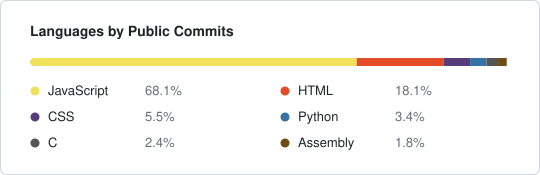

### José Conceição

Computer Science & Engineering student.

I focus on software engineering, low-code platforms, and writing optimized, predictable code — heavily inspired by NASA/JPL's Power of Ten rules.

---

  <picture>
    <source media="(prefers-color-scheme: dark)" srcset="./langs-dark.svg">
    <source media="(prefers-color-scheme: light)" srcset="./langs-light.svg">
    
  </picture>

 

---

## Contact Me

  
  &nbsp;
  
  &nbsp;
  
  &nbsp;
  

